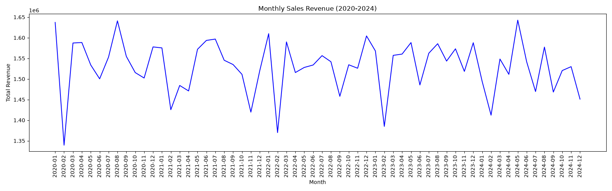
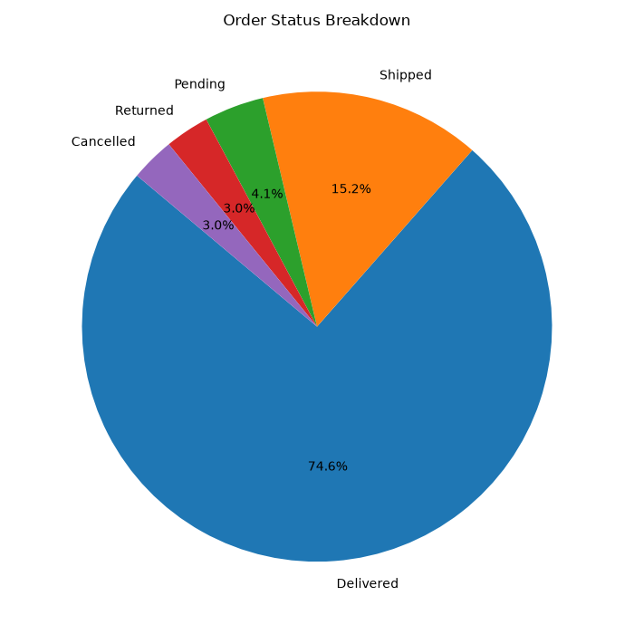
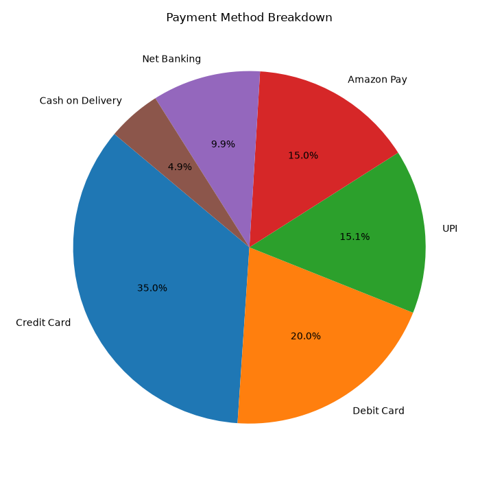
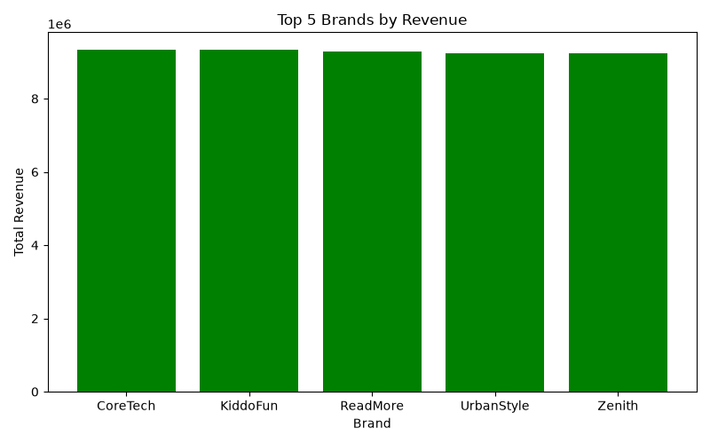
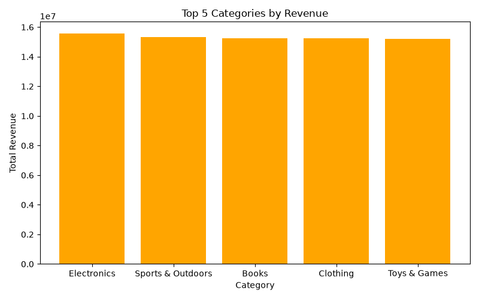
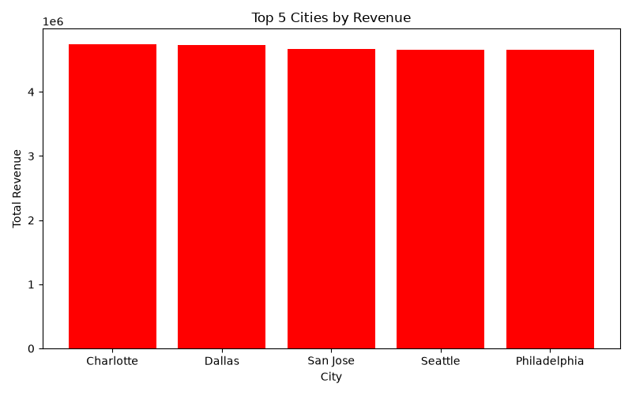
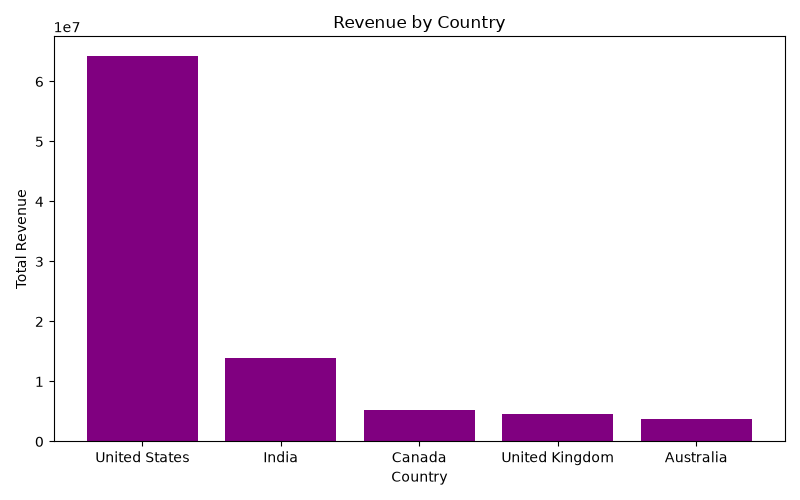

# E-Commerce Sales Analysis

Data Analytics internship project completed at **ViChan Technology (OPC) Private Limited, Tiruchirappalli** (25 May 2026 to 25 June 2026).

## Project Overview
Analysis of an Amazon e-commerce sales dataset from Kaggle to find sales trends, top products, payment preferences and regional revenue.

## Tools Used
- Python
- Pandas
- NumPy
- Matplotlib
- Jupyter Notebook / PyCharm

## What I Did
- Cleaned the data (removed missing values and duplicates, converted data types)
- Calculated total sales and revenue by category, brand, city and country
- Analysed monthly sales trends from 2020 to 2024
- Studied order status and payment method breakdowns
- Created 7 charts with Matplotlib

## Key Findings
- Monthly revenue stayed between about 1.35M and 1.65M from 2020 to 2024
- 74.6% of orders were delivered, and only 3% were cancelled or returned
- Credit Card is the most used payment method (35%)
- Electronics is the top revenue category
- The United States has the highest revenue
- Top cities: Charlotte, Dallas, San Jose, Seattle, Philadelphia
- Top brands: CoreTech, KiddoFun, ReadMore, UrbanStyle, Zenith

## Charts

## Files
- `amazonsalesanalysis.py`: main analysis code
- `project completion notebook.pdf`: project report
- `.png` files: output charts

## Author
Lakshmi | BSc Computer Science
GitHub: [Lakshmi18-cyber](https://github.com/Lakshmi18-cyber)
